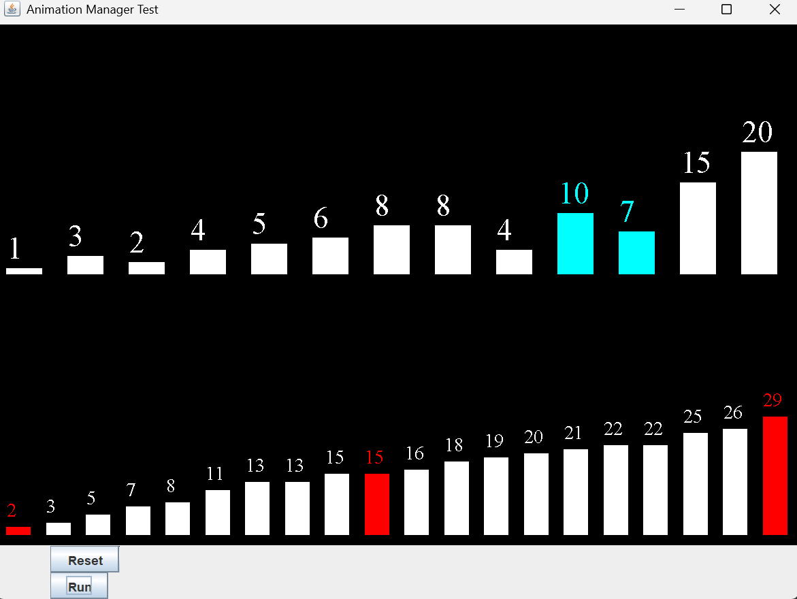

# Sorting Algorithm Animator App:
Status: Prototype

A library of classes and interfaces used to display an algorithm being sorted in real time.

## Applied concepts:
### Observer pattern: Observer and Subject relationship
#### Implementation of Sorting Animation System:
It is implemented using the interfaces: Observer, Subject, and Event.
Observer = AnimationUnit class
Subject = classes that implement Sorter Interface. Like MergeSort and BubbleSort.
Event = SortingEvent interface

The Sorter interface extends the Subject interface.
While sorting an array the BubbleSort and MergeSort classes create a SortingEvent object which stores drawing and timing instructions for the observers, then pass it into the "onNotify" function.

Sorting Event Constructor: SortingEvent(DurationType duration,ActionType action, int ...selectedIndexes)

By calling onNotify, AnimationUnit is notified and receives the SortingEvent object. Animation unit extracts the data from the object and stores the action Enum and selectedIndexes array into the BarGraphGUI so it can color itself according to the changes made.

Finally, AnimationUnit tells BarGraphGUI to redraw itself.
Then it uses the DurationType Enum to decide how long it should sleep the thread, before allowing the algorithm to continue sorting the array.

## Animation Test:
(animation.tests.AnimUnitTest.java)
This test shows the observer pattern and reset interupt functionality in action.

### App Dev To Do:
- [x] 1.) Implement Sorting Algorithm Classes
  - Merge sort and Bubble sort
- [x] 2.) Implement Timer that records total sort time of each algorithm

- [ ] 3.) GUI Implementation
  - [x] Animation visuals implementation.
  - [ ] Elapsed Time output display

- [x] 4.) Basic Animation Thread Interupt functionality. (stop sorting and reset array)

# Project Purpose and Goals:
- implement sorting algorithms.
- apply them to project ideas.

## Sorting Alg Simulator App Summary:
- Generates random unsorted list.
- Has a selected algorithm sort it.
- Visual display shows the user how their array is being sorted in real time.
- Generates time completion data for user to examine algorithm's speed.

    ## Planned Features For Sorting Algorithm Simulation App:
    ### Basic use case scenario: For none comp sci major users.
    INPUTS:
    - User selects type of Sorting  algorithm.
    - User inputs size of lists that will be sorted.
    - User Inputs the seed used to generate lists.
    - User presses "Begin Sort" button to sort that list.
    - User has option to interrupt the sorting while its happening.

    OUTPUT: 
    - User is given sorted list and elapsed sorting time.
    - Every recorded sorting time is stored on list.
    - The fastest sort time recorded will be labled.

    ### Planned Advanced Use Case: For software developers
    - INPUTS:
    - User selects, "Time Complexity Testing" Mode.
    - User selects algorithm
    - User creates "trails rounds" to  test the algorithm
      
    - OUTPUTS:
    - Data is sorted and the algorithm is timed.
    - The times measured for each rounds are stored in Table for user to see.
    - User can Export data into an excel or other table sheet file.
